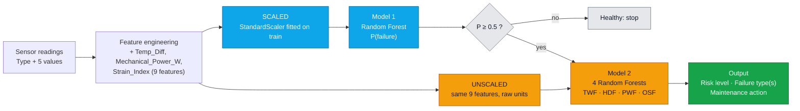

<div align="center">

# Makina Sense
### Predict before the machine stops.

AI-powered predictive maintenance: sensor readings in, **failure risk, failure type and a maintenance action** out.


</div>

## Team

Aiham Bawaneh · Mahmoud Bani-Hani · Mohammad Aljabali · Reem Aldelki · Shahed Alkhawaga

---

## 🎯 Business problem

Unexpected machine downtime causes production delays, costly emergency repairs, and can turn minor equipment issues into major breakdowns. This project explores whether machine learning can predict a machine failure before it happens, giving maintenance teams time to act early instead of reacting after the fact.

| Strategy | How it works | Weakness |
|---|---|---|
| **Reactive** | Wait for a breakdown, then respond | Production stops, repairs are rushed |
| **Preventive** | Service on a fixed calendar | Healthy parts are replaced early; sudden failures still happen |
| **Predictive** (our approach) | Read the sensors, estimate the risk, prioritise inspections | Needs a trustworthy model |

### Objectives

- Predict whether a machine will experience a failure
- Identify the main factors associated with machine failure
- Predict **which kind** of failure to prepare for
- Provide an understandable explanation for the prediction
- Suggest an appropriate maintenance action

> [!NOTE]
> Makina Sense is **decision support** for maintenance teams, not autonomous machine control. The technician stays responsible for the diagnosis.

---

## ⚙️ The system at a glance

Two models work together. **Model 1 decides if** a machine will fail; **Model 2 decides what** kind of failure to expect.



| | Model 1 · *Will it fail?* | Model 2 · *What kind of failure?* |
|---|---|---|
| Algorithm | Random Forest, 100 trees, `class_weight="balanced"` | Four Random Forests (one per type), 300 trees, `class_weight="balanced"` |
| Data | 12,500-row working set (10,000 train / 2,500 test) | Original AI4I rows only (10,000 rows: 8,000 train / 2,000 test, stratified on Machine failure) |
| Features | The 9 features, **scaled** | The same 9 features, **unscaled** (raw units) |
| Output | Failure probability | One probability per failure type (TWF, HDF, PWF, OSF) |

**How the pieces are linked** (`milestone4/ms4_scripts/predict.py`, function `predict_machine`):

1. Model 1 runs on the scaled features and returns the failure probability.
2. **Gate:** only if the probability is at least 0.5 do we continue; otherwise the machine is reported healthy.
3. Model 2 runs on the raw features. Every type with probability at least 0.5 is reported; if none qualifies the result is `Unclassified`.
4. Rules turn the result into advice.

**Risk level** (from the Model 1 probability): below 0.2 Low · below 0.5 Medium · below 0.8 High · otherwise Critical.

**Maintenance actions** are rule-based text, not a trained model:

| Type | Meaning | Action |
|---|---|---|
| TWF | Tool wear failure | Replace the cutting tool. |
| HDF | Heat dissipation failure | Check the cooling system and airflow. |
| PWF | Power failure | Check the power supply and the load (power is outside the safe range). |
| OSF | Overstrain failure | Reduce the load and inspect the tool. |
| Unclassified | Failure of unclear type | General inspection by a maintenance technician. |

> [!IMPORTANT]
> Model 1 was trained on **scaled** features and Model 2 on **unscaled** ones. Each model must receive the version it was trained on, otherwise it returns confident but wrong answers. The saved `StandardScaler` is reused, never refitted.

---

## 📊 Results at a glance

**Model 1 · failure detection** (Random Forest, 2,500 unseen test rows)

| F1 | Accuracy | Precision | Recall | Balanced accuracy |
|---|---|---|---|---|
| **0.9338** | 0.9708 | 0.9626 | 0.9067 | 0.9482 |

Confusion matrix: 1,912 true negatives · 20 false alarms · 53 missed failures · 515 caught failures.

**Model 2 · failure type** (original-data test split, 2,000 rows)

| Type | Test F1 | Positive cases in test | CV F1 |
|---|---|---|---|
| OSF | 1.000 | 16 | 0.995 |
| PWF | 1.000 | 13 | 0.984 |
| HDF | 0.949 | 29 | 0.950 |
| TWF | **0.000** | 10 | 0.063 |

> [!WARNING]
> Read these scores with care. About **87% of the Model 1 test failures (494 of 568) are synthetic**, and Model 2's F1 = 1.000 comes from 13 and 16 test cases of rule-generated data. TWF is not detected. See the Limitations section below.

---

## 🖥️ Web app

A Flask app (`milestone4/ms4_scripts/app.py`) wraps `predict.py` and has three views: **Dashboard**, **Dataset Analysis** and **Single Machine**.

- **Single machine:** the user types the machine type and five sensor readings and gets the failure probability, risk level, failure type(s) and maintenance action.
- **CSV upload (`/api/dataset`):** two modes. `raw` runs the full preprocessing pipeline on a CSV with the 6 raw columns. `scaled` expects a CSV that already went through the Milestone 3 pipeline. If the CSV has a `Machine failure` column, metrics are computed.
- The failure-probability threshold for CSV uploads defaults to 0.5 and is limited to the range 0.05 to 0.95.

### Run it

```bash
pip install -r milestone4/ms4_scripts/templates/requirements.txt
cd milestone4/ms4_scripts
python app.py
```

Then open **http://127.0.0.1:5000**. The app loads the six `.joblib` files from `milestone4/ms4_models/`.

---

## 📦 Dataset

- **Source:** AI4I 2020 Predictive Maintenance Dataset, UCI Machine Learning Repository
- **Original size:** 10,000 rows, 14 columns
- **Working file from Milestone 3 on:** `AI4I_with_synthetic_data_cleaned_data.csv`, 12,500 rows, 14 columns (the 10,000 cleaned original rows plus 2,500 synthetic failure rows)
- **Inputs:** Type (L/M/H) and five readings: air temperature, process temperature, rotational speed, torque and tool wear
- **Features used (9):** Type, the five readings, plus 3 engineered features (Temp_Diff, Mechanical_Power_W, Strain_Index)
- **Targets:** *Machine failure* (0 = no failure, 1 = failure) and the failure-type flags TWF (tool wear), HDF (heat dissipation), PWF (power), OSF (overstrain) and RNF (random)
- **Note:** The dataset is synthetic but designed to reflect realistic industrial predictive-maintenance patterns. The original failure rate is highly imbalanced (3.39% of records are failures). The 12,500-row working file has a 22.71% failure rate because 2,500 synthetic failure rows were added, so that rate is artificial and probabilities should be read as relative risk.
- **Citation:** AI4I 2020 Predictive Maintenance Dataset [Dataset]. (2020). UCI Machine Learning Repository. https://doi.org/10.24432/C5HS5C

---

## 🛠️ Project stages

<details>
<summary><b>Milestone 2 · Data understanding and cleaning</b></summary>

The original dataset had no missing values and no duplicates. To practice a full cleaning workflow, we introduced realistic data issues (missing values and duplicate rows) into a copy of it (`ai4i2020_dirty.csv`, 10,100 rows) and then cleaned it step by step. The statistical outliers are natural to the original data.

**Data quality findings**

- **Missing values:** 4,040 cells across the 5 numeric columns, affecting 3,437 rows (about 34%)
- **Duplicates:** 100 duplicate rows, all exact copies of existing rows (100 UDI values appear twice)
- **Statistical outliers (1.5×IQR rule):** 394 values in Rotational speed and 66 in Torque (460 in total); none in the other three numeric columns
- **Checked and clean:** Type and Product ID (no blanks, valid categories)

**Cleaning decisions** (in the order they run in the notebook)

| # | Decision | Reason |
|---|----------|--------|
| 1 | Treated outliers with IQR clipping: for each numeric sensor column, computed Q1, Q3 and IQR, then capped values to [Q1 − 1.5×IQR, Q3 + 1.5×IQR] with `clip()` | To prevent extreme statistical outliers from skewing the machine learning model while preserving the core data distribution. No rows were removed in this step |
| 2 | Filled missing cells (4,040) with the column mean using `fillna(mean)` | About 34% of rows had at least one blank, so dropping rows would remove a third of the dataset. The mean preserves the average of the sensor readings |
| 3 | Removed duplicate rows with `drop_duplicates()` (100 rows removed) | All 100 duplicates were exact copies, so comparing full rows removes them safely. This step runs last, leaving one row per UDI |

**Before vs after**

| Metric | Before | After |
|--------|--------|-------|
| Total rows | 10,100 | 10,000 |
| Missing cells | 4,040 | 0 |
| Duplicate rows | 100 | 0 |
| Outlier values (1.5×IQR rule) | 460 | 0 (capped to the limits) |
| Machine failure rate | 3.37% | 3.39% |

**Remaining data quality issues (documented, not fixed)**

- **Failure flags vs readings:** in 213 rows (2.1%), the imputed or clipped sensor values no longer reproduce the original HDF, PWF or OSF flag. Mean-filling and clipping give statistical stand-ins, not the true readings, so we kept the original labels.
- **Known quirk of the public dataset:** 27 rows where Machine failure does not match the five failure flags (9 failures without a type flag and 18 flagged rows that are not failures). It exists in the original UCI file.
- **Class imbalance (3.39% failures):** a property of the problem. Synthetic failure rows were added for Milestone 3; the remaining imbalance is handled at the modeling stage.
- **Open question, effect of capping on the failure signal:** only 66 rows have extreme Torque (outside 13.09–66.99 Nm), yet 58 of them (88%) are failures, versus 3.39% overall, and they hold about 17% of all failures. Capping these values may have weakened this warning sign. We planned to compare results with and without capping (using Recall); this comparison has **not been performed** and remains a follow-up.

</details>

<details>
<summary><b>Milestone 3 · EDA, statistics and preprocessing</b></summary>

**Goal:** explore the data, then produce a dataset that is fully numeric, standardized, and split into train and test without leakage, ready for modeling.

**Dataset used.** One file only: `AI4I_with_synthetic_data_cleaned_data.csv` (12,500 rows). We do not use the 15,000-row file and we do not merge the two files, because their first 10,000 rows are shared. Merging would repeat rows, so a copy of the same row could land in both train and test (data leakage).

| Subset | Rows | Failures | Failure rate |
|--------|------|----------|--------------|
| Original (UDI ≤ 10,000) | 10,000 | 339 | 3.39% |
| Synthetic (UDI > 10,000) | 2,500 | 2,500 | 100% |
| Whole file | 12,500 | 2,839 | 22.71% |

**Key insights from the EDA** (`1_EDA_and_Statistics_Notebook.ipynb`)

- Torque above 50 Nm raises failure risk 3.46× (51.16% vs 14.79%), which supports an early warning at 50 Nm.
- Tool wear above 200 min raises risk 3.11× (56.55% vs 18.16%). Risk stays around 12–20% up to 175 min, then jumps (33%, 52%, 79%).
- Rotational speed and torque are inversely related (r ≈ −0.72, consistent with power = torque × speed); failures cluster at low speed and high torque.
- Product type (L/M/H) is a weak failure indicator on its own (failure rate 24.4%, 18.8%, 23.6%).
- Feature scales differ hugely (variance 30,918 for speed vs 2.56 for process temperature), so standardization is required.
- Correlation is not causation: torque ↔ failure r ≈ 0.26, speed ↔ torque r ≈ −0.72, air ↔ process temperature r ≈ 0.63.
- These figures are measured on the 12,500-row working set, which includes the synthetic failure rows.

**Preprocessing pipeline** (`2_Data_Preprocessing_Pipeline.ipynb`)

The order is fixed, because any step that learns statistics from the data (the scaler) must come after the split.

**Feature engineering → Feature selection → Encoding → Train/Test split → Scaling (fit on train only) → Final check**

| Feature | Formula | Physical reason | Correlation with target |
|---------|---------|-----------------|-------------------------|
| Temp_Diff | Process temp − Air temp | Cooling efficiency; a small gap means weak cooling (linked to HDF) | −0.12 |
| Mechanical_Power_W | Torque × rpm × 2π/60 | Mechanical power in watts; very low or high power means a power failure (PWF) | 0.22 |
| Strain_Index | Torque × Tool wear | Cumulative stress: high torque on a worn tool (linked to OSF) | 0.31 |

| Column | Decision | Evidence |
|--------|----------|----------|
| UDI | Dropped | All 2,500 rows above 10,000 are synthetic failures, so a model could read the row number |
| Product ID | Dropped | 10,000 unique IDs in 12,500 rows (one repeats 115 times), so the same ID could sit in train and test; its L/M/H letter already exists in Type |
| TWF, HDF, PWF, OSF, RNF | Dropped | Machine failure equals any of them in 99.78% of rows, so they are the answer itself (target leakage) |

- **Encoding:** Type is mapped explicitly to L=0, M=1, H=2 (ordinal) instead of LabelEncoder, which sorts alphabetically and would give H=0, L=1, M=2.
- **Split:** 80/20 with `stratify=y` and `random_state=42` → 10,000 train rows and 2,500 test rows, with failure rates 22.71% and 22.72%.
- **Scaling:** StandardScaler on the 8 continuous columns (Type is left as is), fitted on the training set only and then applied to the test set.
- **Outputs:** `train_ready_milestone3.csv` (10,000 × 10), `test_ready_milestone3.csv` (2,500 × 10) and `scaler_milestone3.joblib`.

**Limitation:** the synthetic rows were generated on the full data before the train/test split. We checked that no identical rows appear in both train and test, but synthetic rows built from original rows may still land in both sets. A better approach is to split first and over-sample the training set only.

</details>

<details>
<summary><b>Milestone 4 · Model 1: failure detection</b></summary>

**Goal:** train several classification models on the Milestone 3 data, compare them fairly, choose one, and evaluate it honestly on unseen data. Notebook: `milestone4/ms4_notebooks/failure_detection.ipynb`. Presentation: `milestone4/ms4_presentations/makina_sense_model.pptx`.

There is no separate validation set: stratified 5-fold cross-validation (`StratifiedKFold(5, shuffle=True, random_state=42)`, same folds for every model) on the training set plays that role. The model is chosen by the highest mean cross-validated F1; the test set is used once at the end.

**Cross-validation (5-fold, training set)**

| Model | CV Accuracy | CV Precision | CV Recall | CV F1 |
|-------|-------------|--------------|-----------|-------|
| **Random Forest** | 0.9705 | 0.9670 | 0.9009 | **0.9327** |
| Gradient Boosting | 0.9658 | 0.9701 | 0.8767 | 0.9208 |
| Decision Tree | 0.9462 | 0.8836 | 0.8794 | 0.8812 |
| KNN | 0.9353 | 0.9558 | 0.7499 | 0.8402 |
| Logistic Regression | 0.6993 | 0.4074 | 0.7111 | 0.5179 |

**Unseen test set (2,500 rows)**

| Model | Accuracy | Precision | Recall | F1 | Balanced Accuracy |
|-------|----------|-----------|--------|----|-------------------|
| **Random Forest** | 0.9708 | 0.9626 | 0.9067 | **0.9338** | 0.9482 |
| Gradient Boosting | 0.9668 | 0.9691 | 0.8820 | 0.9235 | 0.9369 |
| Decision Tree | 0.9428 | 0.8645 | 0.8873 | 0.8758 | 0.9232 |
| KNN | 0.9316 | 0.9501 | 0.7377 | 0.8305 | 0.8631 |
| Logistic Regression | 0.7040 | 0.4119 | 0.7077 | 0.5207 | 0.7053 |

**Why Random Forest:** highest mean CV F1 and CV recall; CV F1 (0.9327) and test F1 (0.9338) are almost identical, with no sign of overfitting. Gradient Boosting is close and slightly more precise, but Random Forest catches more failures (test recall 0.9067 vs 0.8820), which matters more for maintenance, so recall broke the tie. Logistic Regression is far behind: failures depend on non-linear combinations of conditions.

**Why not accuracy:** always predicting "no failure" already scores about 77% on the working set (96.6% on the original data), so we judge by precision, recall and F1.

**Feature importance (Random Forest built-in)**

| Rank | Feature | Importance |
|------|---------|------------|
| 1 | Rotational speed | 0.2006 |
| 2 | Temp_Diff (engineered) | 0.1951 |
| 3 | Mechanical_Power_W (engineered) | 0.1593 |
| 4 | Torque | 0.1447 |
| 5 | Tool wear | 0.1276 |
| 6 | Strain_Index (engineered) | 0.0617 |
| 7 | Air temperature | 0.0555 |
| 8 | Process temperature | 0.0492 |
| 9 | Type | 0.0063 |

Importance shows what the model uses to predict, not what causes failures.

</details>

<details>
<summary><b>Final stage · Model 2, linking code and web app</b></summary>

**Goal:** go from "will it fail?" to "what kind of failure?", link the two models into one system, and wrap it in a web interface.

- **Model 2** (`milestone4/ms4_notebooks/failure_type.ipynb`): four binary Random Forests (300 trees, `class_weight="balanced"`), one per failure type (TWF, HDF, PWF, OSF), trained on the **original 10,000 rows only**. Synthetic and cleaned rows are left out because their type labels do not follow the physical rules. The split is 8,000 train / 2,000 test, stratified on Machine failure. The features are the 9 features in their **original, unscaled units**.
- **RNF** (random failure, 19 cases) is not modelled: it is random by design.
- **Why four models:** a machine can have more than one failure type at once (24 rows have several flags), so each type is its own yes/no question and the probabilities are independent (they do not add up to 100%).
- **Why the easy types are easy:** they follow clear physical rules in the simulated data (for example, Strain_Index above 11,000 for type L, 12,000 for M and 13,000 for H always meant an OSF failure in the original data), and our engineered features encode those rules.
- **Why TWF fails:** only 46 examples, and tool-wear failures happen at a random moment inside a 200 to 240 minute wear window, so there is no sharp pattern to learn.
- **Saved models** (`milestone4/ms4_models/`): `model_failure.joblib`, `model_TWF.joblib`, `model_HDF.joblib`, `model_PWF.joblib`, `model_OSF.joblib`, `scaler_milestone3.joblib` and `type_model_features.json`.
- **Test scripts:** `test_predict.py` (runs example machines through `predict_machine`) and `test_api.py` (the `/api/dataset` endpoint, raw and scaled modes).

</details>

---

## ⚠️ Limitations

We state these openly, because they change how the scores should be read.

- **The test score reflects the prepared dataset, not real machines.** The 2,500 synthetic rows are all failures and were generated before the split. About **87% of the Model 1 test failures (494 of 568) are synthetic**, so the headline metrics are likely higher than performance on real failures. The notebooks do not report an original-only test score.
- **TWF is not detected** (test F1 = 0.000 on 10 cases).
- **RNF is not modelled** (19 cases, random by design).
- **Label inconsistencies:** 27 rows where Machine failure does not match the type flags (9 failures with no type flag, 18 flagged rows that are not failures).
- **Model 2 CV protocol:** its cross-validation runs on the whole original 10,000-row file, separately from the 80/20 test split.
- **Scaled CSV mode:** the type models expect raw values, so uploads in scaled mode are only approximate for failure types.
- **No input range validation:** the app checks that values are numbers, not that they are physically plausible. Scores are not calibrated and the 0.5 thresholds are defaults.
- The default model settings were used (no hyperparameter search), and the scaler that produced the final CSV files was fitted on the whole training set, so cross-validation folds share a tiny amount of scaling information (negligible for tree models).

---

## 🚀 Next steps

| Priority | Step |
|---|---|
| **P0 · Fix the evidence** | Report Model 1 on original-only test rows; split first and over-sample the training set only · Run Model 2 cross-validation on the training split only · Collect more real failures, especially TWF |
| **P1 · Fix the pipeline** | Correct the pre-scaled CSV handling for the type models · Run `test_predict.py` and `test_api.py` and commit the output · Tune hyperparameters with Grid Search · Add input range validation to the app |
| **P2 · Prepare for field use** | Tune the decision threshold to the cost of a missed failure · Calibrate probabilities · Validate on real machine logs with human review · Compare results with and without outlier capping |

> **Release gate:** reproducible execution, an original-only evaluation and verified end-to-end predictions before any real-world use.

---

## 🗂️ Repository contents

```
README.md
Makina_Sense_model_final_presentation.pptx
milestone1/
├── ms1_data/          ai4i2020_original_data.csv
├── ms1_notebooks/     show_data_code.ipynb
└── ms1_presentations/ predictive_maintenance.pptx
milestone2/
├── ms2_data/          ai4i2020_dirty.csv, cleaned_data.csv
├── ms2_notebooks/     clean_data_code.ipynb, dirty_data_code.ipynb
└── ms2_presentations/ data_cleaning.pptx
milestone3/
├── ms3_data/synthetic_data/
│       AI4I_with_synthetic_data.csv
│       AI4I_with_synthetic_data_1000.csv
│       AI4I_with_synthetic_data_1000_cleaned_data.csv
│       AI4I_with_synthetic_data_cleaned_data.csv
├── ms3_notebooks/     1_EDA_and_Statistics_Notebook.ipynb
│                      2_Data_Preprocessing_Pipeline.ipynb
│                      scaler_milestone3.joblib
│                      synthetic_data_code.ipynb
└── ms3_presentations/ eda_preprocessing.pptx
milestone4/
├── ms4_data/          train_ready_milestone3.csv, test_ready_milestone3.csv
├── ms4_models/        model_failure.joblib, model_TWF/HDF/PWF/OSF.joblib,
│                      scaler_milestone3.joblib, type_model_features.json
├── ms4_notebooks/     failure_detection.ipynb, failure_type.ipynb
├── ms4_presentations/ makina_sense_model.pptx
└── ms4_scripts/       app.py, predict.py, test_api.py, test_predict.py,
                       static/, templates/ (index.html, requirements.txt)
```

| Stage | What is inside |
|---|---|
| **Milestone 1** | Data loading and initial exploration, the original dataset, the presentation |
| **Milestone 2** | `dirty_data_code.ipynb` builds the dirty copy; `clean_data_code.ipynb` does IQR clipping, mean imputation and duplicate removal; `cleaned_data.csv` is the result |
| **Milestone 3** | Synthetic data code and files; EDA notebook; preprocessing pipeline; the fitted scaler; the train/test files |
| **Milestone 4 and final** | Model 1 and Model 2 notebooks; the six saved models; `predict.py` (linking code); `app.py` (web app); test scripts |
| **Final presentation** | `Makina_Sense_model_final_presentation.pptx` in the repository root |

## ▶️ How to run

1. Install the requirements for the notebooks: `pip install pandas numpy matplotlib seaborn scikit-learn joblib`
2. Open the notebooks in Jupyter Notebook or Google Colab. The notebooks read their CSV from a path in the first cells, so update that path to where the files are on your computer (for Milestone 3, the input is `milestone3/ms3_data/synthetic_data/AI4I_with_synthetic_data_cleaned_data.csv`).
3. **Milestone 1:** run `milestone1/ms1_notebooks/show_data_code.ipynb`
4. **Milestone 2:** run `milestone2/ms2_notebooks/clean_data_code.ipynb` to reproduce `cleaned_data.csv` from `ai4i2020_dirty.csv` (set the file path in the first cell to `ai4i2020_dirty.csv`)
5. **Milestone 3:** run `1_EDA_and_Statistics_Notebook.ipynb` for the analysis, then `2_Data_Preprocessing_Pipeline.ipynb` to regenerate `train_ready_milestone3.csv`, `test_ready_milestone3.csv` and `scaler_milestone3.joblib`
6. **Model 1:** run `milestone4/ms4_notebooks/failure_detection.ipynb`. Set the two paths in the loading cell to `milestone4/ms4_data/train_ready_milestone3.csv` and `milestone4/ms4_data/test_ready_milestone3.csv`.
7. **Model 2:** run `milestone4/ms4_notebooks/failure_type.ipynb`.
8. **Web app:** see "Run it" in the Web app section above.

Results can differ slightly in the last decimals between scikit-learn versions.

## ✅ Status

- **Milestone 1:** Dataset selection, loading, and initial exploration: complete
- **Milestone 2:** Data understanding and cleaning: complete
- **Milestone 3:** EDA, statistics and data preprocessing: complete
- **Milestone 4:** Model 1, five models compared with cross-validation, Random Forest selected: complete
- **Final project:** Model 2 (failure type), linking code and web app, final presentation (`Makina_Sense_model_final_presentation.pptx`): complete